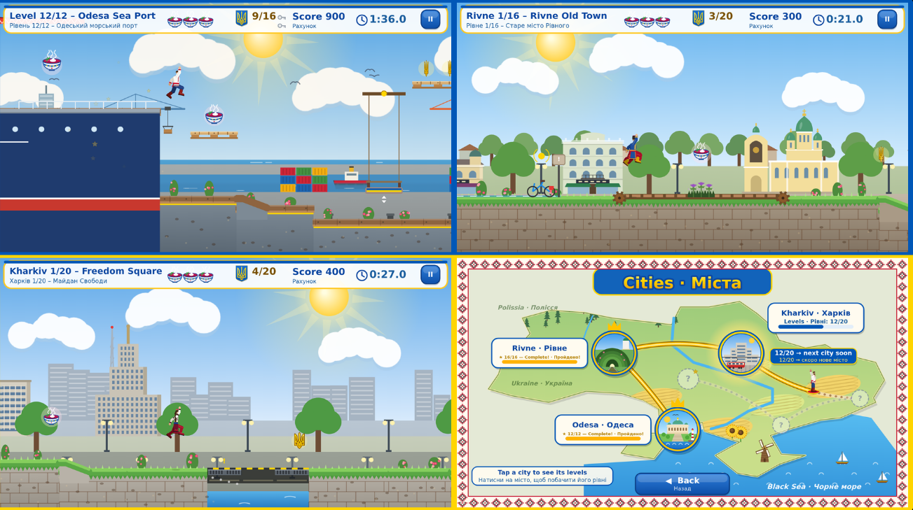
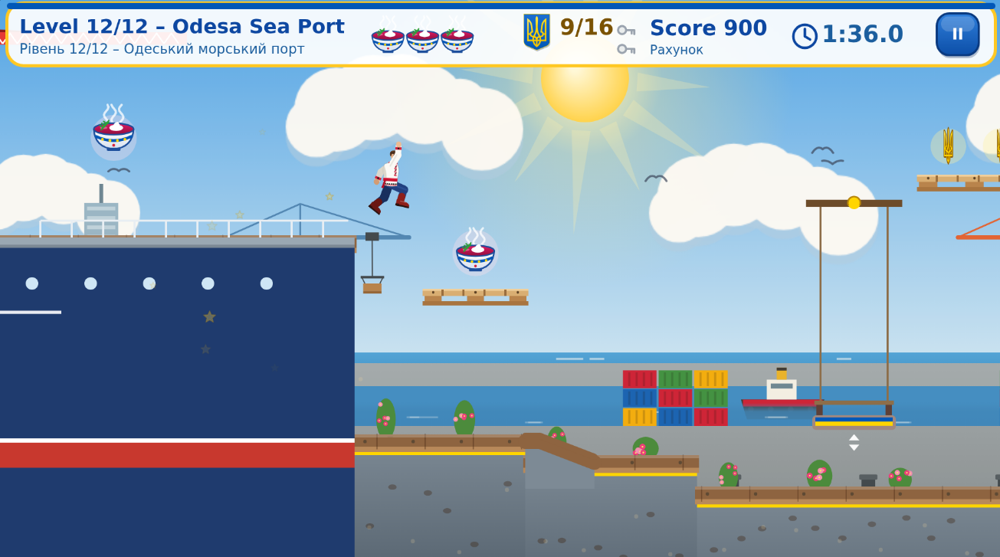
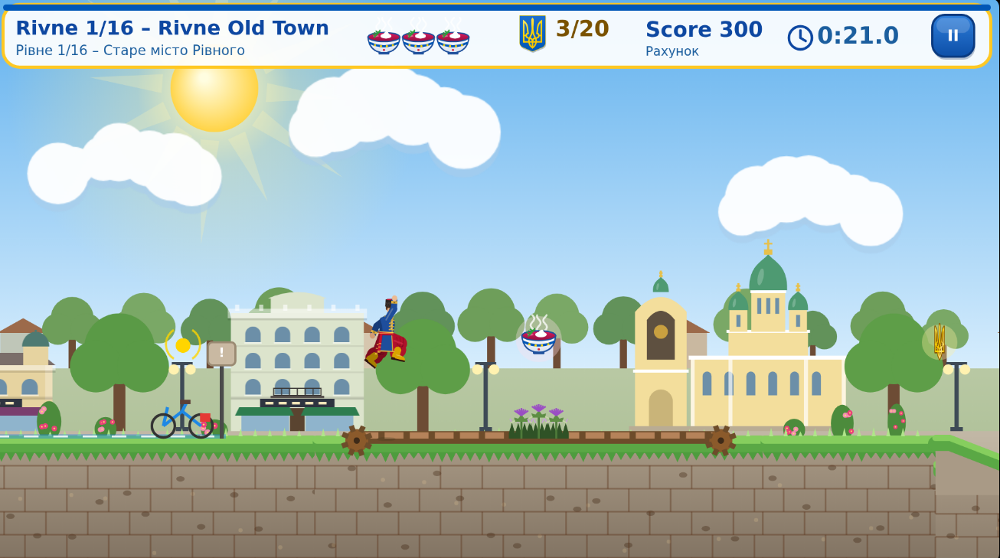
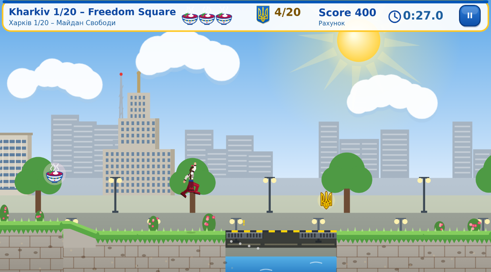
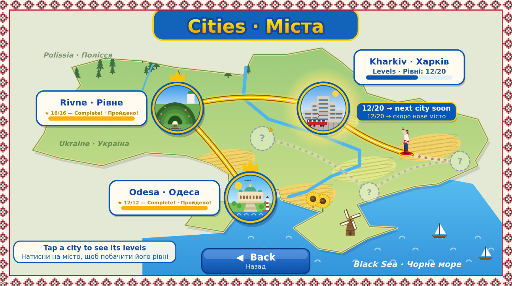
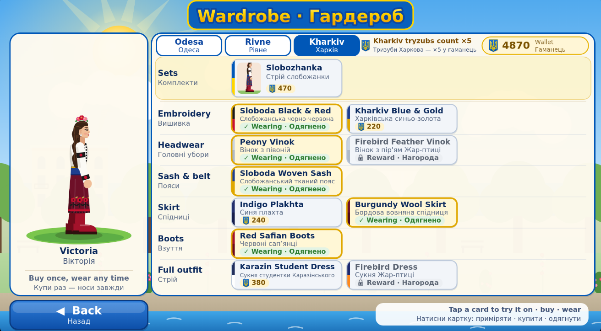

# Taras-Golden-Tryzubs

Taras and the Golden Tryzubs is a cosy bilingual (English / Ukrainian) side-scrolling platformer set across real places in Ukraine.

Play as Taras or Victoria and collect golden tryzubs through three cities so far: sunny Odesa (12 levels + Golden Stork bonus), Rivne (16 levels + Big Red Crab), and Kharkiv (20 levels + Golden Firebird). Jump, bounce, and outwit traps inspired by each place — beaches, parks, markets, winter ice, ports, and more — with themed secret rooms and a few mischievous guardians along the way.

Spend tryzubs on outfits in the wardrobe, modest upgrades, and a 96-card Souvenir Album of real postcards. Unlock city achievements and the rare Golden Master set. Progress is shared between characters; only the wardrobe is personal.

Built for keyboard and touch. Слава Україні!

«Тарас і Золоті Тризуби» — затишний двомовний (українська / англійська) платформер із реальними місцями України.

Грайте за Тараса або Вікторію й збирайте золоті тризуби вже в трьох містах: сонячна Одеса (12 рівнів + бонус Золотий лелека), Рівне (16 рівнів + Великий червоний краб) і Харків (20 рівнів + Золота Жар-птиця). Стрибайте, відбивайтесь і обходьте пастки, натхненні кожним місцем — пляжі, парки, базари, зимовий лід, порт тощо — з тематичними тайними кімнатами й кількома жвавими охоронцями.

Тризуби можна витратити на вбрання в гардеробі, скромні покращення та альбом із 96 листівками-сувенірами. Відкривайте досягнення міст і рідкісний комплект «Золотий майстер». Прогрес спільний для обох героїв; окремий лише гардероб.

Керування з клавіатури та на дотик. Слава Україні!

## Screenshots

